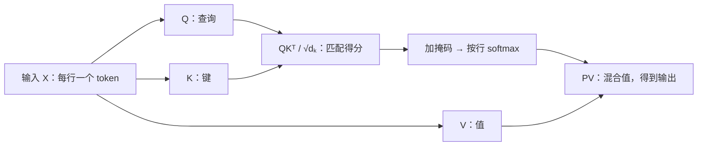

# Attention 预览课：从一个向量读懂 Attention

当前默认从[基础桥接](../curriculum/FOUNDATION_BRIDGE.md)开始。本课保留为可选预览；如果符号和矩阵运算尚不熟悉，可以稍后再读。

这是一节约 **70 分钟的预览课**：用已经熟悉的向量和矩阵，走通一次注意力计算。你不必现在掌握 Transformer 的全部结构；本节的终点是看懂公式、检查维度，并能手算一个输出。

起点：[先做起点诊断](../curriculum/DIAGNOSTIC.md) · 路线：[16 周课程](../curriculum/ROADMAP.md) · 查询：[符号字典](../glossary/SYMBOLS.md) · 观察：[交互演示中的“注意力”](../demos/index.html)

## 这节课要解决的问题

一句话里，一个位置怎样从其他位置收集有用的信息？先把它想成一次“查资料”：当前位置提出查询，各位置提供匹配线索和可取回的内容。计算先决定各取多少，再把内容混合起来。

这个比喻只帮助记住三个角色。模型里的查询、线索和内容都是通过训练得到的数字向量，并不对应真实的提问或理解过程。

| 用时 | 学习动作 | 完成标志 |
|---|---|---|
| 10 分钟 | 认识行向量、矩阵形状与投影 | 能判断矩阵是否可乘 |
| 15 分钟 | 手算一个查询的注意力 | 得到三个权重和一个输出向量 |
| 10 分钟 | 拖动查询方向，预测再观察 | 能解释图上的变化 |
| 15 分钟 | 扩展到所有位置与因果掩码 | 能逐项标出公式维度 |
| 20 分钟 | 独立练习、复述与自查 | 离开教材仍能重建计算链 |

## 1. 先把维度贴到每一个对象上

本项目默认：**一个 token 占一行，特征沿列排列**。token 是分词器划分出的单元，可能是字、子词、标点等，不一定是一个完整单词。

设一段序列有 $n$ 个 token，每个 token 用 $d_{\text{model}}$ 个实数表示：

$$X\in\mathbb{R}^{n\times d_{\text{model}}}.$$

读作：“$X$ 属于 $n$ 行、$d_{\text{model}}$ 列的实数矩阵集合。”矩阵的第 $i$ 行 $x_i$ 是第 $i$ 个 token 的表示。它的形状是 $1\times d_{\text{model}}$。

线性层用同一个参数矩阵 $W$ 处理每一行：

$$\underbrace{X}_{n\times d_{\text{model}}}\underbrace{W}_{d_{\text{model}}\times d_{\text{out}}}=\underbrace{Z}_{n\times d_{\text{out}}}.$$

相邻的两个维度必须相等。$W$ 改变每个 token 的特征表示；这一步不把不同 token 的行混合起来。一般线性层还可以有偏置，本节先省略。

Attention 会生成三份表示：

$$Q=XW_Q,\qquad K=XW_K,\qquad V=XW_V.$$

| 对象 | 本节的含义 | 形状 |
|---|---|---|
| $W_Q,W_K$ | 生成查询与键的可训练参数 | $d_{\text{model}}\times d_k$ |
| $W_V$ | 生成值的可训练参数 | $d_{\text{model}}\times d_v$ |
| $Q,K$ | 所有位置的查询、键 | $n\times d_k$ |
| $V$ | 所有位置待混合的内容 | $n\times d_v$ |

查询和键必须有相同的特征维度，才能做点积；值的特征维度可以不同。

## 2. 让一个查询完成一次计算

用三个位置、每个位置两个数的小例子：

$$X=\begin{bmatrix}1&0\\0&1\\-1&0\end{bmatrix},\qquad W_Q=W_K=W_V=I_2.$$

$I_2$ 是二阶单位矩阵，因此本例 $Q=K=V=X$。这只是方便手算的教学设定，真实模型的三个投影通常不同。

先取第一个位置的查询 $q=[1,0]$，暂时**不使用因果掩码**：

| 位置 | 键 $k_j$ | 值 $v_j$ | $qk_j^\top$ |
|---|---|---|---|
| 1 | $[1,0]$ | $[1,0]$ | $1$ |
| 2 | $[0,1]$ | $[0,1]$ | $0$ |
| 3 | $[-1,0]$ | $[-1,0]$ | $-1$ |

把向量画成箭头：$q$ 朝右，三个键依次朝右、朝上、朝左。点积满足

$$qk_j^\top=\lVert q\rVert_2\lVert k_j\rVert_2\cos\theta_j.$$

本例向量长度都为 1，所以点积只随夹角变化。一般情况下，长度也会影响得分，点积不能直接等同于余弦相似度。

### 第一步：匹配得分

将点积除以 $\sqrt{d_k}$。这里 $d_k=2$：

$$s=\left[\frac{1}{\sqrt{2}},0,-\frac{1}{\sqrt{2}}\right]\approx[0.707,0,-0.707].$$

为什么要缩放？在一个常用的近似中，若查询、键的各分量独立、均值为 0、方差为 1，点积的方差随 $d_k$ 增长。除以 $\sqrt{d_k}$ 可以让得分尺度较稳定，减少 softmax 过度饱和。这是动机，不是对所有训练状态都成立的统计保证。

### 第二步：把得分变成配额

对这一行做 softmax：

$$p_j=\frac{\exp(s_j)}{\sum_{\ell=1}^{3}\exp(s_\ell)}.$$

读作：“第 $j$ 个权重等于第 $j$ 个得分的指数，除以这一行所有指数的和。”分母中的 $\ell$ 是求和用的临时下标。

$$p\approx[0.575975,\ 0.283995,\ 0.140029].$$

这些权重非负、加起来等于 1。它们描述这次计算的混合比例，并非“词语预测概率”。

### 第三步：按配额混合值

$$o=\sum_{j=1}^{3}p_jv_j=pV.$$

$$o\approx0.576[1,0]+0.284[0,1]+0.140[-1,0]=[0.435946,\ 0.283995].$$

读作：“输出等于所有值向量的加权和。”键参与决定权重，值提供被混合的内容。它们在本例中数值相同，但角色不同。

直观上，输出箭头向右上方：向右的值取得最多，但向上、向左的值也参与了混合。在这个不含输出投影的单头例子里，输出处于三个值向量的凸包内。

## 3. 先预测，再打开演示

进入[交互演示](../demos/index.html)，选择“注意力”。先保留三个位置都可见，再做以下观察。图里的二维向量是人为构造的教学向量，不是模型学到的真实词向量。

1. 查询箭头从朝右转到朝上时，哪个位置的权重会最大？向右和向左的位置会怎样？
2. 只改变值向量、保持查询与键不变，权重会变化吗？输出会变化吗？这一项可以直接用手算验证。
3. 固定查询 $q=[1,0]$，打开因果掩码：查询位置选 1 时只允许看 $k_1$，选 2 时允许看 $k_1,k_2$。分别预测权重和输出，再操作验证。提示：屏蔽后要在剩余位置之间重新分配权重。

演示允许独立改变查询方向和查询位置，方便分开观察两种影响。因此，调整后不再要求查询等于前面固定的 $XW_Q$ 的对应行；这是对注意力部件的局部实验。真实模型中，查询由输入及其投影参数共同决定。

一次只改一个因素。你需要解释“哪个计算环节发生了变化”，而不是只描述图的外观。

## 4. 从一个查询，扩展到所有查询

把刚才的三步对所有位置一起计算：

$$\underbrace{S}_{n\times n}=\frac{\underbrace{Q}_{n\times d_k}\underbrace{K^\top}_{d_k\times n}}{\sqrt{d_k}}.$$

$S_{ij}$ 表示第 $i$ 个查询对第 $j$ 个键的得分。**行是发起查询的位置，列是被查询的位置**。

$$P=\operatorname{softmax}_{\text{row}}(S+M),\qquad O=PV.$$

| 对象 | 形状 | 你应该如何读取 |
|---|---|---|
| $S$ | $n\times n$ | 每个位置对其他位置的得分 |
| $M$ | $n\times n$ | 允许或禁止哪些连接 |
| $P$ | $n\times n$ | 每一行独立归一化的混合权重 |
| $O$ | $n\times d_v$ | 每个位置收集信息后的结果 |

有些资料把权重矩阵写作 $A$，因此使用 $AV$；本项目本节用 $P$ 表示权重，写作 $PV$。理解对象比记住某个字母更重要。

### 因果掩码：未来位置暂时不可见

自回归模型在位置 $i$ 预测下一个 token 时，只能使用当前位置及其之前的信息：

$$M_{ij}=\begin{cases}0,&j\le i,\\-\infty,&j>i.\end{cases}$$

因为 $\exp(-\infty)=0$，未来位置的权重成为 0，剩余位置重新归一化。三位置的因果掩码为：

$$M=\begin{bmatrix}0&-\infty&-\infty\\0&0&-\infty\\0&0&0\end{bmatrix}.$$

因此，本例第一个位置使用因果掩码后，只能取自己的值，输出变成 $[1,0]$。前面的 $[0.435946,0.283995]$ 是**无遮罩**的计算结果。不要把两种设定混在一起。

实现时必须保证每个参与计算的查询至少有一个可见键；整行都被屏蔽会使普通 softmax 的归一化没有定义。

## 5. 关掉答案，独立完成

1. **形状检查：**若 $n=5,d_{\text{model}}=8,d_k=4,d_v=6$，分别写出 $W_Q,Q,K^\top,S,P,O$ 的形状。为什么 $QK$ 不符合这里所需的计算？
2. **方向变化：**将查询换成 $q=[0,1]$，三个键和值保持不变，不加掩码。计算得分、权重和输出，保留三位小数。
3. **角色区分：**保持原始查询、键不变，将第三个值改为 $v_3=[10,0]$。权重是否变化？新输出是多少？
4. **掩码：**若某个查询的未掩码得分为 $[1/\sqrt{2},0,-1/\sqrt{2}]$，只允许前两个键，输出是什么？仍用最初的三个值。
5. **softmax 性质：**给同一行的所有得分同时加上 100，权重是否改变？为什么实际计算常用减去该行最大值的写法？
6. **一分钟复述：**不看公式，用自己的话说明 $Q,K,V$ 分别做什么；再写出完整公式，并在下面标出每个矩阵的维度。

完成后再看：答案与解释

1. $W_Q:8\times4$；$Q:5\times4$；$K^\top:4\times5$；$S,P:5\times5$；$O:5\times6$。$QK$ 的内维度 $4$ 与 $5$ 不匹配。即使某个特殊例子恰好可乘，所需语义仍是“每个查询与每个键做点积”，对应 $QK^\top$。
2. 得分为 $[0,0.707,0]$，权重约 $[0.248,0.503,0.248]$，输出约 $[0,0.503]$。对称的左右向量抵消。
3. 权重不变，仍约 $[0.575975,0.283995,0.140029]$。新输出为 $[0.575975+10\times0.140029,0.283995]\approx[1.976,0.284]$。
4. 权重约为 $[0.669762,0.330238,0]$；输出约为 $[0.670,0.330]$。屏蔽后必须重新归一化，不能直接沿用旧权重。
5. 不变，因为分子和分母都乘上相同的 $e^{100}$，会约去。减去最大值利用同样的性质，避免大正数的指数溢出。对于非常小的权重，浮点数仍可能出现下溢，因此数值稳定不是无限精度。
6. 合格复述至少包含：“查询与键计算匹配；按行 softmax 生成归一化权重；权重用于混合值；因果掩码限制信息来源。”公式为 $O=\operatorname{softmax}_{\text{row}}(QK^\top/\sqrt{d_k}+M)V$。

## 6. 本节常见误解

- **“Attention 就是在挑一个最重要的词。”** softmax 通常产生连续混合，很多位置都可能参与；有些专门设计的机制才会明确稀疏或离散选择。
- **“权重越大，就越能解释模型为什么这么回答。”** 注意力权重反映内部一次混合，不能单独作为可靠的因果解释。
- **“每行加起来等于 1，所以每列也一样。”** 按行归一化只约束行；每列的和一般不同。
- **“一个 Attention 公式就是完整的 LLM。”** 完整模型还包括多头、输出投影、残差、归一化、前馈网络、位置信息，以及训练目标等。本节只展开了一个部件。
- **“看过动画就掌握了。”** 应当能预测变化、重建公式，并独立完成一个未见过的小例子。

## 7. 记录证据，再决定下一步

完成本课后，把自己的形状检查、一个手算结果和复述保存为学习证据。第 1、2、4、6 题可独立完成，说明你已经具备继续沿主线学习的起点；这不等于已经掌握整个 M7 注意力模块。

若矩阵维度容易混淆，回到 M1 的张量与线性代数几何；若缩放的统计解释或指数归一化不清楚，在 M3 补齐概率与信息论；反向传播与训练的细节将在 M2、M5、M6 展开。

建议在学习后的第 1、3、7、14 天分别做一次不看答案的短复习：重画数据流 → 重做形状题 → 换一组数字手算 → 解释因果掩码。这是可调整的复习建议，不会自动创建提醒。

## 来源与例子范围

缩放点积注意力的原始定义见 Vaswani 等人的 [Attention Is All You Need](https://arxiv.org/abs/1706.03762)，§3.2.1。后续阅读可重点对照该节公式中的 $Q,K,V$ 和 $\sqrt{d_k}$。

本课二维向量、数值、练习和“查资料”类比均为自编教学材料，不是论文实验结果，也不是从真实 LLM 提取的词向量或注意力数据。
